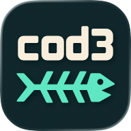
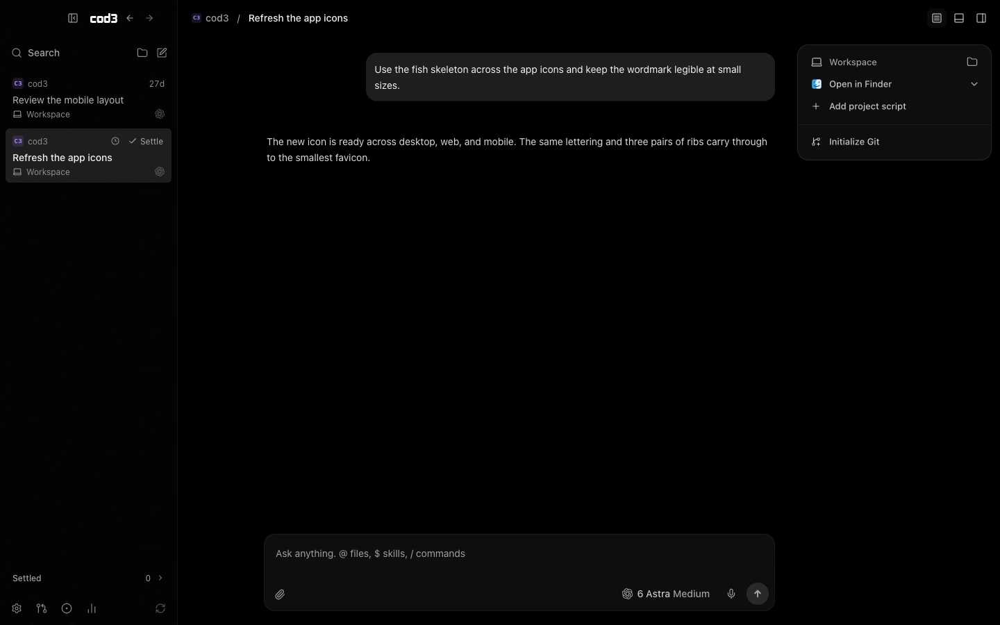

<p align="center">
  <a href="https://github.com/salexandr0s/cod">
    
  </a>
</p>

<h1 align="center">cod3</h1>

<p align="center">The open-source control plane for coding agents.</p>

<p align="center">
  <a href="https://github.com/salexandr0s/cod/releases"><strong>Download</strong></a> ·
  <a href="./apps/mobile/README.md">Mobile</a> ·
  <a href="./docs/README.md">Docs</a> ·
  <a href="https://discord.gg/jn4EGJjrvv">Discord</a>
</p>

cod3 runs the coding agents on your machine and gives them one fast interface. Start a thread at your desk, then approve the next step from your phone.

It works with Claude Code, Codex, Cursor, OpenCode, Grok Build, Antigravity, Kiro, Pi, Muse Code, fx, and any [ACP](./docs/user/providers-acp.md) agent. If an agent is set up on your computer, cod3 can control it.

<p align="center">
  
</p>

## What you get

- **Your subscriptions.** cod3 does not resell tokens. It drives the agents you are already signed in to.
- **Every agent in one place.** Change models in the middle of a thread. Let Claude hand a task to Codex.
- **Desktop, web, and phone.** One server, and every client shows the same threads. There are apps for iOS and Android.
- **Remote ready.** Run agents on any machine. Connect over your local network, Tailscale, or [cod3 Connect](./docs/user/remote-access.md).
- **Git built in.** Each thread can work in its own worktree. Review the diff, then commit, push, and open a pull request with one button.
- **Fast.** Performance is a feature here. We measure it, and we treat a dropped frame as a bug.
- **Open.** MIT licensed. If you don't like something, fork it.

## Install

### Run from source

Install the toolchain and dependencies using the [development runbook](./docs/operations/00_development.md#first-checkout). From the repository root, run:

```sh
vp run dev           # web app and local server
vp run dev:desktop   # Electron desktop app
```

To create a packaged desktop app, follow [Desktop artifacts](./docs/operations/00_development.md#desktop-artifacts). The [mobile setup guide](./apps/mobile/README.md) covers iOS and Android.

### Sign in to an agent

cod3 needs one agent that is installed and signed in. For example, install [Claude Code](https://claude.com/product/claude-code) and run `claude auth login`, or install [Codex CLI](https://developers.openai.com/codex/cli) and run `codex login`.

[Provider setup](./docs/user/install.md#providers) has the steps for each agent. [Install cod3](./docs/user/install.md) covers nightly builds, AppImage, WSL, and NixOS.

## "Wait, what are you selling me?"

Nothing. We built cod3 because we wanted the best possible development experience with agents. We were inspired by existing solutions like the Codex desktop app, Conductor, Claude Desktop and Cursor Glass, but none met our bar.

We wanted something performant, remote-ready, and truly open. If we ever go the wrong direction, we want you to have everything you need to fork and build the tool that you want.

## Documentation

- [Install and first run](./docs/user/install.md)
- [Remote access from a phone or another machine](./docs/user/remote-access.md)
- [Permission modes](./docs/user/permission-modes.md)
- [Source control](./docs/user/source-control.md)
- [Connect outside agents over MCP](./docs/user/outside-agents.md)
- [FAQ](./docs/user/faq.md)

[All docs](./docs/README.md) has the full list.

## Contributing

We have limited review capacity. Small, focused fixes are the most likely to be merged. Features need an approved discussion first.

- Read [CONTRIBUTING.md](./CONTRIBUTING.md) before you report a bug or open a pull request.
- Put feature requests in [Ideas](https://github.com/salexandr0s/cod/discussions/categories/ideas).
- Build from source with the [development runbook](./docs/operations/00_development.md#first-checkout). The [architecture overview](./docs/internals/01_architecture.md) explains how it works.
- Get help in [Discord](https://discord.gg/jn4EGJjrvv).

## License

[MIT](./LICENSE)
